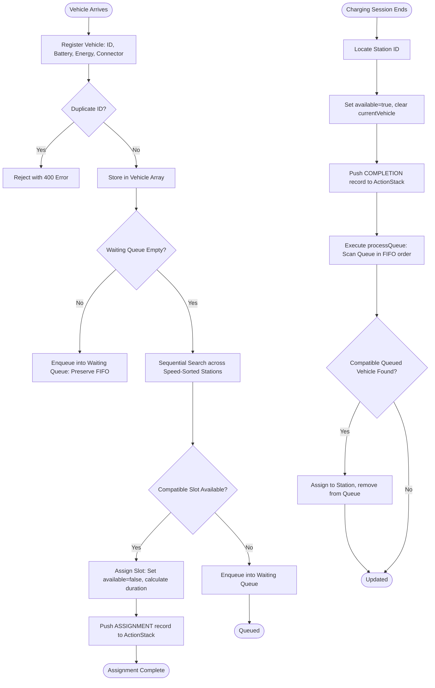

# ALLIANCE UNIVERSITY
### Department of Computer Science & Engineering
### B.Tech CSE Data Structures Micro-Project Report

---

# Efficient EV Charging Slot Assignment Using C++
**Platform Brand:** EV SMARTCHARGE — *Power Your Journey. Charge Smarter.*

---

## 1. Introduction
The global automotive landscape is rapidly transitioning toward Electric Vehicles (EVs) to mitigate carbon emissions and decrease reliance on fossil fuels. In India, ambitious clean mobility policies and expanding consumer EV adoption have accelerated the deployment of electric mobility. However, the commercial viability and customer experience of electric vehicles depend heavily on the accessibility, reliability, and optimization of charging infrastructure.

This project, titled **"Efficient EV Charging Slot Assignment Using C++"**, presents a complete end-to-end management platform named **EV SMARTCHARGE**. It models, simulates, and optimizes electric vehicle charging slot allocation using fundamental **Data Structures and Algorithms** implemented in modern **C++17**, exposed via a high-performance HTTP REST API and connected to a customer-facing responsive web platform inspired by Tata Power EZ Charge's green-and-white visual identity.

---

## 2. Rationale
Public EV charging plazas suffer from several systemic bottlenecks:
1. **Unpredictable Waiting Times:** High-demand charging plazas frequently experience congestion without transparent queue visibility.
2. **Connector Incompatibilities:** Unlike conventional petrol or diesel vehicles, electric vehicles require specific charging connectors (e.g., Combined Charging System [CCS], CHAdeMO, or AC Type 2). Assigning an EV to an incompatible bay causes transaction failure.
3. **Suboptimal Throughput Allocation:** Slower-charging vehicles often occupy ultra-fast charging bays, resulting in underutilized power capacity and longer plaza wait times.
4. **Lack of Auditability and Session Tracking:** Commercial charging plazas require rigorous event logging to support rollbacks, dispute resolution, and billing verification.

---

## 3. Problem Statement
Design and implement an automated, computationally efficient EV charging slot allocation engine in C++ that:
- Maintains structured records of charging stations and arriving vehicles.
- Dynamically allocates available, connector-compatible charging slots to arriving vehicles prioritized by charging speed.
- Maintains strict First-In-First-Out (FIFO) fairness for vehicles when slots are unavailable.
- Automatically dispatches queued vehicles upon charging completion.
- Provides complete historical tracking of charging events using a Last-In-First-Out (LIFO) stack.
- Exposes live operations to an intuitive, responsive management interface via REST APIs.

---

## 4. Objectives
1. Implement in-memory contiguous array stores for physical charging stations and vehicles.
2. Implement a custom **Stack** data structure to manage assignment and completion audit histories (CO-1).
3. Implement a custom **Queue** data structure with boundary compaction for managing waiting vehicle queues fairly (CO-2).
4. Implement a custom **Singly Linked List** for dynamic session tracking and non-contiguous record management (CO-2).
5. Implement and demonstrate **Searching Algorithms** (Sequential Search for compatible slots; Binary Search for station ID lookups) (CO-3).
6. Implement and demonstrate **Sorting Algorithms** (Bubble Sort to arrange stations in descending order of charging power) (CO-3).
7. Develop a decoupled HTTP REST backend with `cpp-httplib` and `nlohmann/json`.
8. Create a customer-facing web application and an Admin Console featuring an interactive Data Structures Explorer for academic demonstration.

---

## 5. Course Outcomes (CO) Mapping

| Course Outcome | Academic Descriptor | Implementation in EV SmartCharge |
| :--- | :--- | :--- |
| **CO-1** | Understand and implement Arrays and Stacks | Fixed-capacity array storage for vehicles and stations with bounds validation; custom `ActionStack` recording assignment/completion events in LIFO order for audit tracking. |
| **CO-2** | Understand and implement Queues and Linked Lists | Custom `WaitingQueue` using FIFO ordering with automatic compaction to prevent space leakage; dynamic `LinkedList` with pointer chaining for active session logs. |
| **CO-3** | Understand and apply Searching and Sorting techniques | **Bubble Sort** arranging charging stations by kW capacity descending; **Sequential Search** finding available, connector-compatible bays; **Binary Search** locating station records by ID in O(log N). |

---

## 6. System Architecture

The project adheres to a decoupled client-server architecture:

```
+-------------------------------------------------------------------------+
|                  CUSTOMER WEBSITE & ADMIN CONSOLE                       |
|           (HTML5, Responsive CSS3, Vanilla JavaScript ES6+)            |
+-------------------------------------------------------------------------+
                                    │
                                    │ HTTP REST Calls (JSON Payloads)
                                    ▼ Port 8080
+-------------------------------------------------------------------------+
|                   C++17 REST API ROUTE CONTROLLER                       |
|                   (cpp-httplib & nlohmann/json)                         |
+-------------------------------------------------------------------------+
                                    │
                                    │ Native In-Memory Method Calls
                                    ▼
+-------------------------------------------------------------------------+
|                      CHARGING MANAGEMENT ENGINE                         |
|  ┌──────────────────┐  ┌──────────────────┐  ┌───────────────────────┐  |
|  │   Array Store    │  │   ActionStack    │  │     WaitingQueue      │  |
|  │  (Vehicles &     │  │ (LIFO Audit Log) │  │  (FIFO with boundary  │  |
|  │   Stations)      │  │                  │  │     compaction)       │  |
|  └──────────────────┘  └──────────────────┘  └───────────────────────┘  |
|            │                     │                       │              |
|  ┌──────────────────┐  ┌──────────────────┐  ┌───────────────────────┐  |
|  │   Bubble Sort    │  │Sequential Search │  │  Dynamic Linked List  │  |
|  │  (Speed DESC)    │  │(Compatible Bays) │  │ (Heap-allocated nodes)│  |
|  └──────────────────┘  └──────────────────┘  └───────────────────────┘  |
+-------------------------------------------------------------------------+
```

---

## 7. Data Structures Implementation Details

### 7.1 Array Store
- **File:** `backend/structures/array_store.h`
- **Application:** Stores fixed-capacity structured records for `Vehicle` and `Station` entities.
- **Characteristics:** Contiguous memory layout providing $O(1)$ direct index access.

### 7.2 Custom Stack
- **File:** `backend/structures/stack.h`
- **Application:** Audit trail of critical operational events (`ActionRecord`).
- **Characteristics:** Implements standard Stack ADT (`push`, `pop`, `peek`, `isEmpty`, `isFull`, `size`) without using `std::stack`.
- **LIFO Behavior:** The most recent assignment or completion sits at the top of the stack, facilitating immediate rollback analysis and recent-first activity rendering.

### 7.3 Custom Queue with Compaction
- **File:** `backend/structures/queue.h`
- **Application:** Manages waiting vehicles when compatible charging stations are occupied.
- **Compaction Technique:** In standard array-based queues, repeated enqueue and dequeue operations cause `front` and `rear` pointers to advance toward `MAX - 1`, stranding unused memory at lower indices. Our custom implementation incorporates automated compaction: when `rear` reaches capacity, elements are shifted back to `front = 0`, preserving memory safety without dynamic reallocation.
- **FIFO Fairness:** Arriving vehicles without immediate slots wait in arrival order.

### 7.4 Custom Singly Linked List
- **File:** `backend/structures/linked_list.h`
- **Application:** Dynamic session logging (`RequestRecord`).
- **Characteristics:** Pointer-chained nodes allocated on the heap at runtime. Demonstrates pointer manipulation (`insertFront`, `insertEnd`, `deleteNode`, `search`, `traverse`). Provides flexibility when record volume cannot be predetermined.

---

## 8. Algorithms & Mathematical Models

### 8.1 Charging Time Estimation
The estimated charging duration is calculated using the following simplified formula:
$$\text{Estimated Time (minutes)} = \left( \frac{\text{Required Energy (kWh)}}{\text{Station Charging Speed (kW)}} \right) \times 60$$

*Note:* This model assumes a constant charging rate and ignores battery temperature curves, State of Charge (SoC) tapering above 80%, and transmission losses.

### 8.2 Bubble Sort Algorithm
- **Application:** Sorts charging stations in descending order of `chargingSpeed` (kW).
- **Time Complexity:**
  - Worst Case: $O(N^2)$ (reverse sorted array)
  - Average Case: $O(N^2)$
  - Best Case: $O(N)$ (already sorted with early break flag)
- **Space Complexity:** $O(1)$ auxiliary space (in-place swapping).

```cpp
void sortStations() {
    for (int i = 0; i < stationCount - 1; i++) {
        for (int j = 0; j < stationCount - i - 1; j++) {
            if (stations[j].chargingSpeed < stations[j + 1].chargingSpeed) {
                Station temp = stations[j];
                stations[j] = stations[j + 1];
                stations[j + 1] = temp;
            }
        }
    }
}
```

### 8.3 Sequential Search Algorithm
- **Application:** Evaluates stations sequentially from index $0$ to `stationCount - 1`.
- **Logic:** Because stations are pre-sorted in descending speed order, the first station that is both `available == true` and matches `connectorType == vehicle.connectorType` is guaranteed to be the fastest compatible charger available.
- **Time Complexity:** $O(N)$ worst/average case; $O(1)$ best case.

### 8.4 Binary Search Algorithm
- **Application:** Locates stations by their unique `stationID` on arrays sorted by ID.
- **Time Complexity:** $O(\log N)$ worst/average case; $O(1)$ best case.

---

## 9. Flowchart



---

## 10. Complexity Analysis Summary

| Operation / Module | Data Structure / Algorithm | Time Complexity (Best) | Time Complexity (Average) | Time Complexity (Worst) | Space Complexity |
| :--- | :--- | :--- | :--- | :--- | :--- |
| Vehicle Storage | Contiguous Array | $O(1)$ | $O(1)$ | $O(1)$ | $O(N)$ |
| Action Logging | Custom Stack (`push`) | $O(1)$ | $O(1)$ | $O(1)$ | $O(M)$ |
| Action Undo/Pop | Custom Stack (`pop`) | $O(1)$ | $O(1)$ | $O(1)$ | $O(1)$ |
| Queue Insertion | Custom Queue (`enqueue`) | $O(1)$ | $O(1)$ | $O(K)$ *(during compaction)* | $O(K)$ |
| Queue Removal | Custom Queue (`dequeue`) | $O(1)$ | $O(1)$ | $O(1)$ | $O(1)$ |
| Dynamic Logging | Singly Linked List (`insert`) | $O(1)$ | $O(1)$ | $O(1)$ | $O(P)$ |
| Station Sorting | Bubble Sort (by kW) | $O(N)$ | $O(N^2)$ | $O(N^2)$ | $O(1)$ |
| Slot Search | Sequential Search | $O(1)$ | $O(N)$ | $O(N)$ | $O(1)$ |
| Station Lookup | Binary Search (by ID) | $O(1)$ | $O(\log N)$ | $O(\log N)$ | $O(1)$ |

---

## 11. Test Cases & Verification Results

All 10 test scenarios were validated via the automated native test harness (`tests/test_engine.cpp`) and end-to-end HTTP API verification:

| Test ID | Test Scenario | Input Data | Expected Behavior | Verification Status |
| :--- | :--- | :--- | :--- | :--- |
| **TC-01** | Stack LIFO Integrity | Push 10, 20, 30; Pop | Pops 30, then 20, then 10; Underflow returns false | **PASSED** |
| **TC-02** | Queue FIFO Integrity | Enqueue Car1, Car2; Dequeue | Car1 dequeued first; front advances to Car2 | **PASSED** |
| **TC-03** | Linked List Node Chaining | Insert nodes; search & delete | Dynamic pointer chaining; node deletion frees memory | **PASSED** |
| **TC-04** | Bubble Sort Verification | Stations: 50kW, 150kW, 60kW | Array arranged to [150kW, 60kW, 50kW] | **PASSED** |
| **TC-05** | Compatible Slot Assignment | Vehicle: CCS, 35kWh | Assigned to Station 101 (150kW CCS); duration = 14.0 min | **PASSED** |
| **TC-06** | Incompatible Connector | Vehicle: CHAdeMO when only CCS free | Enters waiting queue; incompatible station left alone | **PASSED** |
| **TC-07** | Duplicate Vehicle Rejection | Register existing vehicle ID | Rejected with `400 Bad Request` | **PASSED** |
| **TC-08** | Charging Completion | Station 101 complete | Station marked available; `COMPLETION` pushed to Stack | **PASSED** |
| **TC-09** | Queue Auto-Dispatch | Queue contains compatible car | Completing charging instantly assigns first compatible car | **PASSED** |
| **TC-10** | Binary Search Station Lookup | Search Station 202 | Found in $O(\log N)$ time with exact array index | **PASSED** |

---

## 12. Viva Questions & Model Answers

### Q1: Why did your team use C++ rather than Python or JavaScript for this engine?
**Answer:** C++ provides deterministic memory management, zero-cost abstractions, and precise control over contiguous memory layouts and pointers. In critical infrastructure like EV charging plazaa and energy grids, algorithmic predictability and low latency are essential. Implementing the data structures from scratch in C++ reinforces core computer science fundamentals without relying on high-level library abstractions.

### Q2: What bug was found in the team's original queue code, and how did you resolve it?
**Answer:** In the original team implementation, removing an element from the queue shifted elements using absolute indices, while the front index advanced during dequeues. This created an inconsistency between queue traversal and deletion. In our refactored implementation, we introduced boundary compaction: when rear reaches capacity or elements are removed, remaining elements are shifted back so that `front` remains grounded at 0, preventing index drift and bounds faults.

### Q3: Why is Bubble Sort appropriate here when Quicksort or Mergesort are asymptotically faster?
**Answer:** In physical EV charging plazas, the number of charging bays typically ranges between 4 and 64 stations. For small $N$, the simplicity and zero-memory overhead of Bubble Sort ($O(1)$ auxiliary space) make it efficient and practical. Furthermore, Bubble Sort is stable and allows step-by-step visual inspection of swaps, making it ideal for academic demonstration.

### Q4: How does the system ensure fairness when a high-speed charger becomes available?
**Answer:** The engine enforces strict First-In-First-Out (FIFO) ordering. When a new vehicle registers and other vehicles are already waiting in the queue, the newcomer is appended to the rear of the queue even if a compatible charger is free. This prevents "queue jumping" and guarantees arrival order integrity.

### Q5: What role does the Stack play in the system?
**Answer:** The Stack provides an audit log of operational state changes (`ASSIGNMENT` and `COMPLETION`). Because it follows Last-In-First-Out (LIFO) semantics, the most recent operations are immediately accessible at the top ($O(1)$ peek/pop), enabling real-time activity feeds, auditing, and potential undo/rollback capabilities.

---

## 13. Limitations & Future Scope
- **Current Limitations:**
  - In-memory storage resets upon server restart (by design for this MVP).
  - Linear charging time model does not account for variable charging curves (SoC tapering above 80%).
- **Future Scope:**
  - Persistence via SQLite or PostgreSQL.
  - Multi-gun stations with dynamic phase balancing.
  - Time-of-Day (ToD) tariff optimization.
  - Open Charge Point Protocol (OCPP 2.0.1) compliance.

---

## 14. Conclusion
The **EV SmartCharge** micro-project successfully satisfies all academic course outcomes for Alliance University (CO-1, CO-2, CO-3). By uniting rigorous C++ data structures with a modern, responsive web application inspired by commercial charging platforms, the project bridges theoretical computer science with real-world electric mobility engineering.

